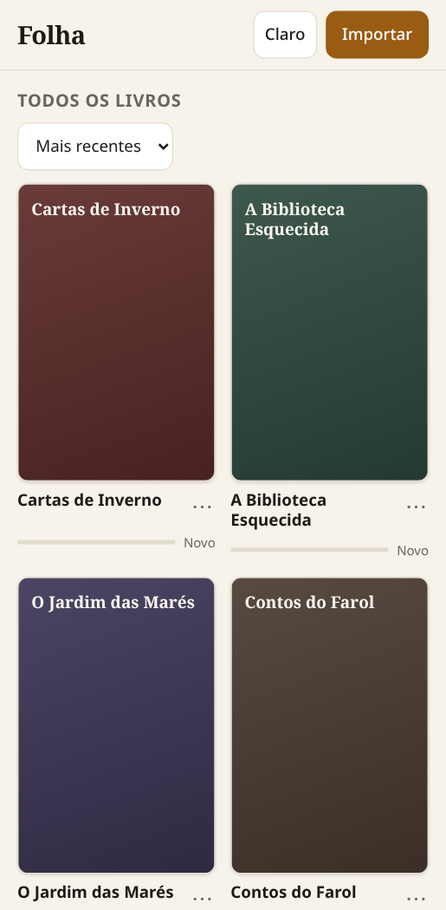
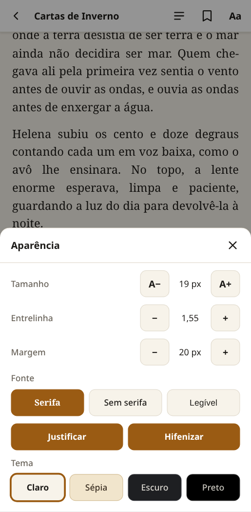

# Folha

Leitor de e-books estilo Kindle para Android (e navegador), feito com TypeScript e Capacitor. Sem contas, sem anúncios e sem rastreamento: seus livros ficam no seu aparelho.

| Estante | Leitor | Painel Aa | Tema escuro |
| :---: | :---: | :---: | :---: |
|  |  |  |  |

## Recursos

- Leitura paginada, com toque, deslize e teclado, barra de progresso e tempo restante.
- Importa **PDF** (convertido em texto refluível), **EPUB** e **TXT/Markdown**.
- Painel **Aa**: tamanho da fonte, entrelinha, margens, família da fonte, justificação e hifenização.
- Temas claro, sépia, escuro e preto.
- Sumário e **marcadores** por página; o progresso de leitura é salvo automaticamente.
- Funciona **offline**: tudo é armazenado localmente (IndexedDB).
- **Sem rastreamento**: nenhum dado sai do aparelho.

## Instalar o APK

1. Baixe o APK mais recente em *Releases* (ou o artefato `folha-debug-apk` da última execução do CI).
2. No Android, permita a instalação de apps de fontes desconhecidas para o navegador ou gerenciador de arquivos usado.
3. Abra o arquivo `.apk` e confirme a instalação.

## Desenvolvimento

Requisitos: Node 22 (veja `.nvmrc`). Para o APK: JDK 21 e Android SDK (plataforma 36).

```bash
npm ci               # instala as dependências
npm run dev          # servidor de desenvolvimento
npm run typecheck    # TypeScript estrito
npm test             # testes unitários (vitest)
npm run test:coverage
npm run test:e2e     # testes de ponta a ponta (Playwright; rode `npx playwright install chromium` antes)
npm run build        # typecheck + build de produção em dist/
npm run convert-pdf -- arquivo.pdf   # valida a conversão de um PDF pela linha de comando
```

### Gerar o APK

```bash
npm run build
npx cap sync android
echo "sdk.dir=$HOME/Android/Sdk" > android/local.properties   # ajuste o caminho do SDK
cd android
./gradlew assembleDebug            # APK em android/app/build/outputs/apk/debug/
./gradlew assembleRelease          # release (minificado), sem assinatura por padrão
```

### Assinar o release

Crie `android/keystore.properties` (já ignorado pelo git, **nunca o versione**):

```properties
storeFile=/caminho/para/folha.jks
storePassword=...
keyAlias=folha
keyPassword=...
```

Com o arquivo presente, `./gradlew assembleRelease` assina o APK automaticamente. Para gerar uma chave: `keytool -genkeypair -v -keystore folha.jks -alias folha -keyalg RSA -keysize 4096 -validity 10000`.

### Capturas de tela

`npm run build && node docs/capturas.mjs` regenera `docs/capturas/*.png` (importa `docs/exemplo.txt` e fotografa em viewport Pixel 7).

## Arquitetura

```
src/
  main.ts        roteador por hash (#/ biblioteca, #/ler/<id> leitor) e botão Voltar do Android
  types.ts       contrato de dados (livro, capítulos, blocos)
  db.ts          IndexedDB: metadados, conteúdo, imagens/capas e chave-valor
  settings.ts    preferências de leitura e temas
  import/        importadores: pdf (+ pdf-layout), epub, txt, html-blocks; index.ts escolhe pelo tipo
  library/       estante, busca, ordenação, importação e arrastar-e-soltar
  reader/        leitor paginado (colunas CSS), HUD, painéis de sumário/marcadores e Aa
  styles/        CSS base, da biblioteca e do leitor
android/         projeto Capacitor (Gradle)
```

## Limitações conhecidas

- PDF escaneado (só imagens) não é convertido em texto: cada página vira uma imagem. Não há OCR.
- PDFs com layout complexo (colunas, tabelas, fórmulas) podem perder a estrutura ao virar texto refluível.
- Não há sincronização entre aparelhos nem DRM.

## Roadmap

- OCR opcional para PDFs escaneados.
- Destaques e anotações.
- Exportar/importar a biblioteca e o progresso (backup).
- Publicação em lojas de apps e instalação via F-Droid.

## Licenças de terceiros

O Folha é distribuído sob a [licença MIT](LICENSE). As dependências de execução são compatíveis com ela:

| Pacote | Licença |
| --- | --- |
| [pdfjs-dist](https://github.com/mozilla/pdf.js) | Apache-2.0 |
| [fflate](https://github.com/101arrowz/fflate) | MIT |
| [@capacitor/core, android, app, status-bar](https://github.com/ionic-team/capacitor) | MIT |

Ferramentas de desenvolvimento (Vite, Vitest, Playwright, TypeScript etc.) não são distribuídas no APK. As bibliotecas AndroidX usadas pelo projeto Android são Apache-2.0.

## Contribuindo

Veja [CONTRIBUTING.md](CONTRIBUTING.md). As mudanças de cada versão estão em [CHANGELOG.md](CHANGELOG.md).
